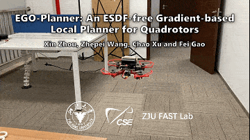
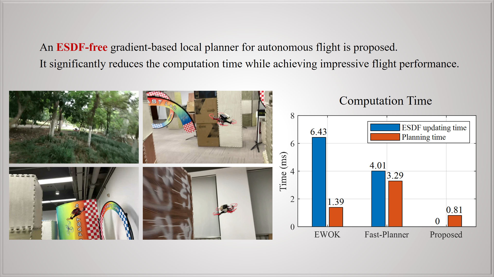
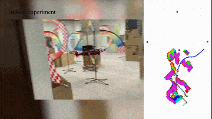
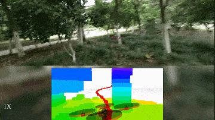
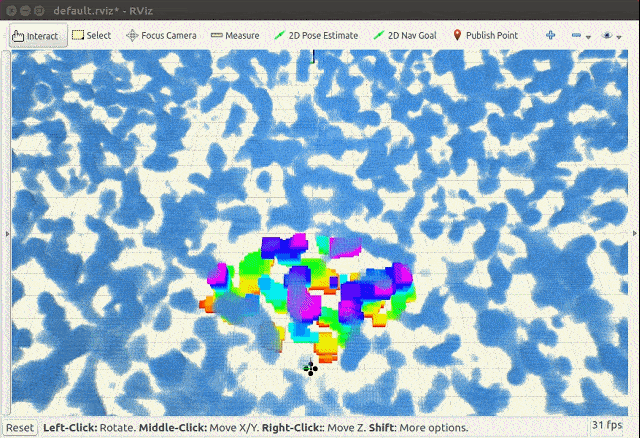
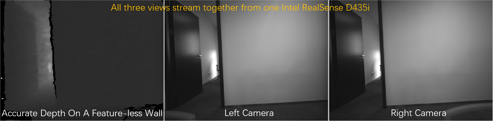

# EGO-Planner Inspection — V3.0.1

基于本仓库的原始 EGO-Planner，实现逐站巡检、实际到达判定、指定航向、RViz 任务显示、手动录包和一条命令回放。每站到达后立即转向，稳定后悬停；V3 在所有巡检点完成后自动返回实际任务起点，逐步下降至 0.21 米稳定保持，再报告任务完成。当前不调用摄像机。

**本版本已验证软件仿真，尚未完成实机接口适配与飞行验证。**保留原规划与避障算法；巡检目标输入现支持配置高度，普通手动选点模式沿用原来的 1 米目标高度。

版本区分：GitHub 的 `main` 和 `codex/inspection-v1` 保留已上传的 V1；最终 V3 仿真源码发布到 `codex/inspection-v3`，版本号为 `3.0.1`。`3.0.0` 是返航下降基线，`3.0.1` 增加逐次规划计时与 CSV 导出。实机移植候选包单独保留，不包含在本次仿真版本中。

控制面板沿用 V2 风格，显示每次全局/局部规划的成功或失败、计算耗时及目标首次轨迹响应时间；支持 CSV 导出，停止仿真后保留上次记录。

本地可视化配置入口：

```bash
./run-local.sh panel
```

浏览器打开 `http://127.0.0.1:8765`，设置速度、高度、点数、各点坐标与航向、转向后悬停时间，然后点击“应用配置并启动仿真”及“开始巡检”。面板使用独立的本机 ROS master，不接管已有仿真。

在已配置 ROS Noetic 和系统依赖的环境中：

```bash
./run-local.sh build
./run-local.sh inspection
# 在另一个终端中，需要录制时才执行：
./run-local.sh record
# 停止录包后，回放最近保存的录包：
./run-local.sh replay
```

巡检点、航向和悬停时间在 `src/planner/plan_manage/launch/inspection.yaml` 中配置。程序默认执行五站路线；`auto_start:=false` 可让仿真等待手动开始。

- [版本记录与验证结果](CHANGELOG.md)
- [V2 仿真验证与实验参数](V2仿真验证.md)
- [前端控制面板说明与联调结果](前端控制面板说明.md)
- [V3 自动返航与低位回收](V3返航回收说明.md)
- [本地部署说明](本地部署说明.md)
- [巡检仿真说明](巡检仿真说明.md)
- [手动录包说明](手动录包说明.md)
- [一条命令回放](一键回放说明.md)
- [实机部署准备与当前限制](实机部署准备.md)

Ubuntu 22.04 使用现有 ROS Noetic 环境的兼容修复保存在 `compat/`，这些配置依赖本机 Noetic 安装情况，不能保证其他机器无需调整即可编译。源码上传不包含编译产物、运行日志或大型 `.bag` 文件；首次使用需要重新编译。已有本机录包仍保留在 `bags/` 中。

下方保留上游项目说明。

---

# Note!
Our recently developed planner [EGO-Swarm](https://github.com/ZJU-FAST-Lab/ego-planner-swarm) is an evolution from EGO-Planner. 
It is more robust and safe, and therefore, is more recommended to use.
If you have only one drone, just set the `drone_id` to `0` in EGO-Swarm's launch files.
Of course, some topic names are changed from EGO-Planner, check it using `rqt_graph` and `rosnode info <package name>`.

# Quick Start within 3 Minutes 
Compiling tests passed on ubuntu **16.04, 18.04 and 20.04** with ros installed.
You can just execute the following commands one by one.
```
sudo apt-get install libarmadillo-dev
git clone https://github.com/ZJU-FAST-Lab/ego-planner.git
cd ego-planner
catkin_make
source devel/setup.bash
roslaunch ego_planner simple_run.launch
```
If your network to github is slow, We recommend you to try the gitee repository [https://gitee.com/iszhouxin/ego-planner](https://gitee.com/iszhouxin/ego-planner). They synchronize automatically.

If you find this work useful or interesting, please kindly give us a star :star:, thanks!:grinning:

# Acknowledgements
- The framework of this repository is based on [Fast-Planner](https://github.com/HKUST-Aerial-Robotics/Fast-Planner) by Zhou Boyu who achieves impressive proformance on quadrotor local planning.

- The L-BFGS solver we use is from [LBFGS-Lite](https://github.com/ZJU-FAST-Lab/LBFGS-Lite). 
It is a C++ head-only single file, which is lightweight and easy to use.

- The map generated in simulation is from [mockamap](https://github.com/HKUST-Aerial-Robotics/mockamap) by William Wu.

- The hardware architecture is based on an open source implemation from [Teach-Repeat-Replan](https://github.com/HKUST-Aerial-Robotics/Teach-Repeat-Replan).

# EGO-Planner 
EGO-Planner: An ESDF-free Gradient-based Local Planner for Quadrotors

**EGO-Planner** is a lightweight gradient-based local planner without ESDF construction, which significantly reduces computation time compared to some state-of-the-art methods <!--(EWOK and Fast-Planner)-->. The total planning time is only **around 1ms** and don't need to compute ESDF.

<p align = "center">




</p>

**Video Links:** [YouTube](https://youtu.be/UKoaGW7t7Dk), [bilibili](https://www.bilibili.com/video/BV1VC4y1t7F4/) (for Mainland China)

## 1. Related Paper
EGO-Planner: An ESDF-free Gradient-based Local Planner for Quadrotors, Xin Zhou, Zhepei Wang, Chao Xu and Fei Gao (Accepted by RA-L). [arXiv Preprint](https://arxiv.org/abs/2008.08835), [IEEE Xplore](https://ieeexplore.ieee.org/abstract/document/9309347), and [IEEE Spectrum report](https://spectrum.ieee.org/automaton/robotics/robotics-hardware/video-friday-mit-media-lab-tf8-bionic-ankle).

## 2. Standard Compilation

**Requirements**: ubuntu 16.04, 18.04 or 20.04 with ros-desktop-full installation.

**Step 1**. Install [Armadillo](http://arma.sourceforge.net/), which is required by **uav_simulator**.
```
sudo apt-get install libarmadillo-dev
``` 

**Step 2**. Clone the code from github or gitee. This two repositories synchronize automaticly.

From github,
```
git clone https://github.com/ZJU-FAST-Lab/ego-planner.git
```

Or from gitee,
```
git clone https://gitee.com/iszhouxin/ego-planner.git
```

**Step 3**. Compile,
```
cd ego-planner
catkin_make -DCMAKE_BUILD_TYPE=Release
```

**Step 4**. Run.

In a terminal at the _ego-planner/_ folder, open the rviz for visuallization and interactions
```
source devel/setup.bash
roslaunch ego_planner rviz.launch
```

In another terminal at the _ego-planner/_, run the planner in simulation by
```
source devel/setup.bash
roslaunch ego_planner run_in_sim.launch
```

Then you can follow the gif below to control the drone.

<p align = "center">

</p>

## 3. Using an IDE
We recommend using [vscode](https://code.visualstudio.com/), the project file has been included in the code you have cloned, which is the _.vscode_ folder.
This folder is **hidden** by default.
Follow the steps below to configure the IDE for auto code completion & jump.
It will take 3 minutes.

**Step 1**. Install C++ and CMake extentions in vscode.

**Step 2**. Re-compile the code using command
```
catkin_make -DCMAKE_BUILD_TYPE=Release -DCMAKE_EXPORT_COMPILE_COMMANDS=Yes
```
It will export a compile commands file, which can help vscode to determine the code architecture.

**Step 3**. Launch vscode and select the _ego-planner_ folder to open.
```
code ~/<......>/ego-planner/
```

Press **Ctrl+Shift+B** in vscode to compile the code. This command is defined in _.vscode/tasks.json_.
You can add customized arguments after **"args"**. The default is **"-DCMAKE_BUILD_TYPE=Release"**.

**Step 4**. Close and re-launch vscode, you will see the vscode has already understood the code architecture and can perform auto completion & jump.

 ## 4. Use GPU or Not
 Packages in this repo, **local_sensing** have GPU, CPU two different versions. By default, they are in CPU version for better compatibility. By changing
 
 ```
 set(ENABLE_CUDA false)
 ```
 
 in the _CMakeList.txt_ in **local_sensing** packages, to
 
 ```
 set(ENABLE_CUDA true)
 ```
 
CUDA will be turned-on to generate depth images as a real depth camera does. 

Please remember to also change the 'arch' and 'code' flags in the line of 
```
    set(CUDA_NVCC_FLAGS 
      -gencode arch=compute_61,code=sm_61;
    ) 
``` 
in _CMakeList.txt_. If you encounter compiling error due to different Nvidia graphics card you use or you can not see proper depth images as expected, you can check the right code via [link1](https://arnon.dk/matching-sm-architectures-arch-and-gencode-for-various-nvidia-cards/) or [link2](https://github.com/tpruvot/ccminer/wiki/Compatibility).
 
Don't forget to re-compile the code!

**local_sensing** is the simulated sensors. If ```ENABLE_CUDA``` **true**, it mimics the depth measured by stereo cameras and renders a depth image by GPU. If ```ENABLE_CUDA``` **false**, it will publish pointclouds with no ray-casting. Our local mapping module automatically selects whether depth images or pointclouds as its input.

For installation of CUDA, please go to [CUDA ToolKit](https://developer.nvidia.com/cuda-toolkit)

## 5. Utilize the Full Performance of CPU
The computation time of our planner is too short for the OS to increase CPU frequency, which makes the computation time tend to be longer and unstable.

Therefore, we recommend you to manually set the CPU frequency to the maximum.
Firstly, install a tool by
```
sudo apt install cpufrequtils
```
Then you can set the CPU frequency to the maximum allowed by
```
sudo cpufreq-set -g performance
```
More information can be found in [http://www.thinkwiki.org/wiki/How_to_use_cpufrequtils](http://www.thinkwiki.org/wiki/How_to_use_cpufrequtils).

Note that CPU frequency may still decrease due to high temperature in high load.

# Improved ROS-RealSense Driver

We modified the ros-relasense driver to enable the laser emitter strobe every other frame, allowing the device to output high quality depth images with the help of emitter, and along with binocular images free from laser interference.

<p align = "center">

</p>

This ros-driver is modified from [https://github.com/IntelRealSense/realsense-ros](https://github.com/IntelRealSense/realsense-ros) and is compatible with librealsense2 2.30.0.
Tests are performed on Intel RealSense D435 and D435i.

Parameter ```emitter_on_off``` is to turn on/off the added function.
Note that if this function is turned on, the output frame rate from the device will be reduced to half of the frame rate you set, since the device uses half of the stream for depth estimation and the other half as binocular grayscale outputs.
What's more, parameters ```depth_fps``` and ```infra_fps``` must be identical, and ```enable_emitter``` must be true as well under this setting.

##  Install

The driver of librealsense2 2.30.0 should be installed explicitly.
On a x86 CPU, this can be performed easily within 5 minutes.
Firstly, remove the currently installed driver by 
```
sudo apt remove librealsense2-utils
```
or manually remove the files if you have installed the librealsense from source.
Then, you can install the library of version 2.30.0 by
```
sudo apt-key adv --keyserver keys.gnupg.net --recv-key F6E65AC044F831AC80A06380C8B3A55A6F3EFCDE || sudo apt-key adv --keyserver hkp://keyserver.ubuntu.com:80 --recv-key F6E65AC044F831AC80A06380C8B3A55A6F3EFCDE
```
For ubuntu 16.04
```
sudo add-apt-repository "deb http://realsense-hw-public.s3.amazonaws.com/Debian/apt-repo xenial main" -u
```
For ubuntu 18.04
```
sudo add-apt-repository "deb http://realsense-hw-public.s3.amazonaws.com/Debian/apt-repo bionic main" -u
```
Then continue with
```
sudo apt-get install librealsense2-dkms
sudo apt install librealsense2=2.30.0-0~realsense0.1693
sudo apt install librealsense2-gl=2.30.0-0~realsense0.1693
sudo apt install librealsense2-utils=2.30.0-0~realsense0.1693
sudo apt install librealsense2-dev=2.30.0-0~realsense0.1693
sudo apt remove librealsense2-udev-rules
sudo apt install librealsense2-udev-rules=2.30.0-0~realsense0.1693
``` 
Here you can varify the installation by 
```
realsense-viewer
```

##  Run

If everything looks well, you can now compile the ros-realsense package named _modified_realsense2_camera.zip_ by ```catkin_make```, then run ros realsense node by 
```
roslaunch realsense_camera rs_camera.launch
```
Then you will receive depth stream along with binocular stream together at 30Hz by default.

<!--
# A Lightweight Quadrotor Simulator

The quadrotor simulator we use is inherited and modified from [Fast-Planner](https://github.com/HKUST-Aerial-Robotics/Fast-Planner). 
It is lightweight and super easy to use.
Only one topic is required to control the drone.
You can execute 
```
roslaunch so3_quadrotor_simulator simulator_example.launch 
```
to run a simple example in ego-planner/src/uav_simulator/so3/control/src/control_example.cpp.
If this simulator is helpful to you, plaease kindly give a star to [Fast-Planner](https://github.com/HKUST-Aerial-Robotics/Fast-Planner) as well.-->

# Licence
The source code is released under [GPLv3](http://www.gnu.org/licenses/) license.

# Maintaince
We are still working on extending the proposed system and improving code reliability. 

For any technical issues, please contact Xin Zhou (iszhouxin@zju.edu.cn) or Fei GAO (fgaoaa@zju.edu.cn).

For commercial inquiries, please contact Fei GAO (fgaoaa@zju.edu.cn).
